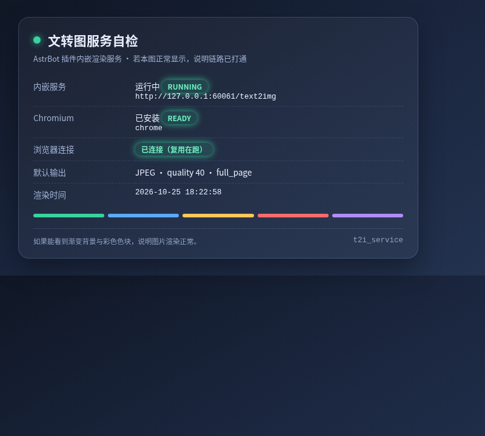
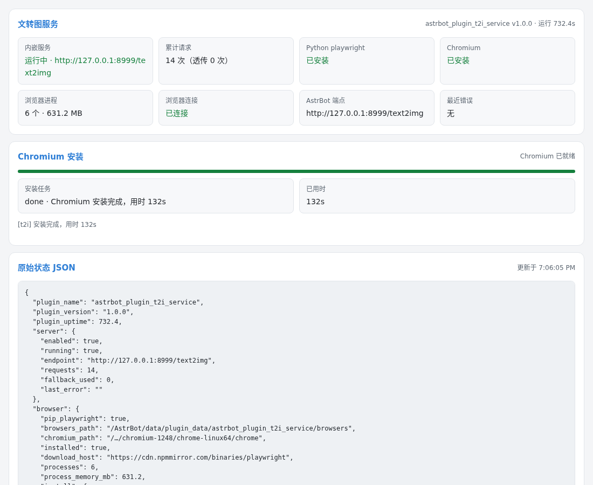
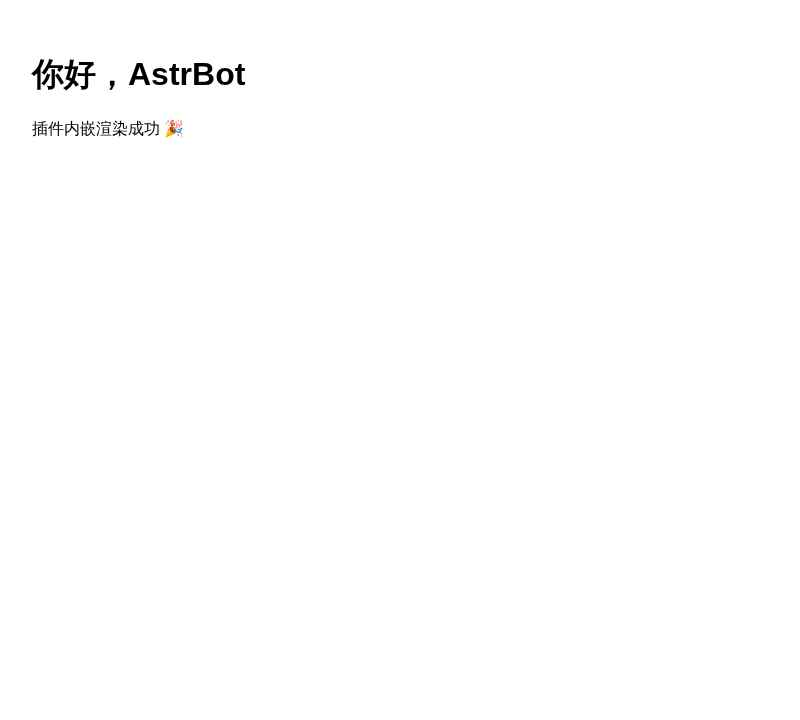

# 文转图服务插件（AstrBot Plugin）

把 [astrbot-t2i-service](https://github.com/AstrBotDevs/astrbot-t2i-service) 装进 AstrBot 进程：不需要再单独跑一个 Docker 容器，AstrBot 的「文转图」开箱即用，HTML / 模板渲染在 AstrBot 自己的进程里完成。

[English](README_en.md) | 简体中文



## 它解决什么问题

AstrBot 的文转图能力默认走「远端端点」（`t2i_strategy: remote` + `t2i_endpoint`）。官方端点在外网，速度取决于网络；自建又意味着多维护一个容器、端口和镜像。

本插件把同一套渲染服务直接嵌入 AstrBot：

- 复用 AstrBot 自己的 Python 环境，不再新增一个容器与端口映射；
- 渲染在进程内完成，本机回环通信，无跨机延迟；
- 自带 Chromium 下载器（支持镜像源）、状态检测、残留进程清理与自动端点写入；
- 自动检查 Chromium 的系统运行库，缺库时自行补装，不让「浏览器装好了却一渲染就崩」卡住；
- HTTP 契约与上游完全一致，AstrBot 主程序与任何兼容客户端都不用改代码。

| 对比项 | 官方公共端点 | 独立容器 | 本插件 |
| --- | --- | --- | --- |
| 额外部署 | 无 | 需要 Docker | 无 |
| 延迟 | 取决于公网 | 本机/内网 | 本机进程内 |
| Chromium 供给 | 远端负责 | 需自行维护镜像 | 插件内一键下载 |
| 与 AstrBot 版本同步 | 无关 | 需手动同步 | 同一进程，自动跟随 |

## 安装

1. 在 AstrBot WebUI「插件市场」中安装本插件（或把本仓库放进 `data/plugins/astrbot_plugin_t2i_service`）。
2. 插件安装时只会 `pip install playwright`（约 40 MB 的 Python 包），**不会**自动下载 Chromium。
3. 重启 AstrBot，在插件配置里确认 `server.enabled` 与 `server.port`（默认 `127.0.0.1:8999`）。
4. 下载 Chromium（约 200 MB，默认走 npmmirror 镜像）：在插件配置页打开「下载 Chromium 浏览器」开关并保存即可开始，或发送 `/t2i_install`（`/t2i_install mirror` 走国内镜像）。若容器缺系统运行库，安装流程会接着补装依赖。
5. 发送 `/t2i_test` 验证出图；成功后文转图即可用。若需自动写入 AstrBot 端点，打开配置 `endpoint.auto_configure` 或点 WebUI 页面上的「应用端点」。

> 渲染图默认落在插件数据目录 `data/plugin_data/astrbot_plugin_t2i_service/data/`，24 小时后自动清理。

## 命令

| 命令 | 说明 |
| --- | --- |
| `/t2i_status` | 查看服务地址、浏览器状态、系统依赖、渲染统计与并发情况 |
| `/t2i_install` | 下载并安装 Chromium（`/t2i_install mirror` 走国内镜像）；浏览器已装好但缺系统运行库时，自动补装依赖 |
| `/t2i_test` | 渲染自检卡片并回图，用于验证整条链路 |
| `/t2i_restart` | 重启内嵌渲染服务并关闭浏览器 |

## 配置

配置项在 WebUI 插件配置页分组展示（`_conf_schema.json`）：

### `browser` — 安装 Chromium 浏览器

| 键 | 默认值 | 说明 |
| --- | --- | --- |
| `download_chromium` | `false` | 打开并保存配置即开始下载 Chromium，无需发指令；下载结束后开关自动关闭（成功或失败都会关），开关一直显示 |
| `chromium_ready` | `false` | 是否已就绪，插件自动维护、仅供查看：开启即可直接渲染，不用再点下载 |
| `browsers_path` | 空 | 浏览器安装目录，空则用插件数据目录 `browsers/` |
| `download_host` | `https://cdn.npmmirror.com/binaries/playwright` | Playwright 浏览器下载源 |
| `executable_path` | 空 | 复用系统里已有的 Chromium |
| `auto_install_deps` | `true` | 缺系统运行库时自动补装（需 root 与 apt/dnf；环境不支持时只提示，不报错） |
| `cleanup_orphans` | `true` | 启动时结束上次遗留的 Chromium |
| `install_timeout_seconds` | `900` | 下载超时 |

### `server` — 内嵌渲染服务

| 键 | 默认值 | 说明 |
| --- | --- | --- |
| `enabled` | `true` | 是否启用内嵌服务 |
| `host` | `127.0.0.1` | 监听地址。插件与 AstrBot 同进程，保持回环即可；只有要被 AstrBot 之外的机器/容器访问时才改 `0.0.0.0` |
| `port` | `8999` | 监听端口 |
| `auth_token` | 空 | 非空时要求 `Authorization: Bearer <token>` |
| `fallback_enabled` | `true` | 本机渲染失败时透传上游公共端点 |
| `fallback_endpoint` | `https://t2i.rcfortress.site/text2img` | 透传目标（图片会下载到本地再返回；可填自建服务地址） |

### `endpoint` — 接入 AstrBot

| 键 | 默认值 | 说明 |
| --- | --- | --- |
| `current_service_url` | 空 | 本插件当前地址，插件按监听地址与端口自动写入（默认 `http://127.0.0.1:8999/text2img`），仅供查看 |
| `auto_configure` | `false` | 启动时把端点写进 AstrBot 配置，并打开「文本转图像输出」总开关 |
| `service_url` | 空 | 要写入的端点地址，空则按监听地址自动生成 |

### `render` — 渲染行为

| 键 | 默认值 | 说明 |
| --- | --- | --- |
| `concurrency` | `2` | 并发渲染数（同时打开的页面数） |
| `no_sandbox` | `true` | 以 `--no-sandbox` 启动 Chromium；AstrBot 官方镜像以 root 运行，必须开启 |
| `idle_timeout_seconds` | `300` | 空闲多久后关闭 Chromium 释放内存 |
| `prelaunch` | `false` | 启动时预热浏览器，首图更快但启动稍慢 |
| `default_type` | `jpeg` | 请求未指定 `type` 时的输出格式 |
| `default_quality` | `40` | JPEG 默认质量 |
| `full_page` | `true` | 默认整页截图 |

### `storage` — 图片清理

| 键 | 默认值 | 说明 |
| --- | --- | --- |
| `image_lifetime_hours` | `24` | 渲染图片保留时长 |
| `cleanup_interval_minutes` | `60` | 清理间隔 |

## 接入 AstrBot 文转图

插件提供与上游一致的端点，需要让 AstrBot 知道它：

- **查地址**：配置页「接入 AstrBot 文转图」中的「本插件当前地址」就是应填进 AstrBot「文本转图像服务 API 地址」的值（默认 `http://127.0.0.1:8999/text2img`，改了监听地址或端口后自动更新）；
- **自动**：打开 `endpoint.auto_configure`（或点 WebUI 插件页面上的「应用端点」），插件会把该地址写入 AstrBot、切到远程策略，并打开 AstrBot 的「文本转图像输出」总开关——总开关关着时文转图不会生效；
- **手动**：在 AstrBot `data/cmd_config.json` 中确认：

```jsonc
{
  "t2i": true,
  "t2i_strategy": "remote",
  "t2i_endpoint": "http://127.0.0.1:8999/text2img"
}
```

写入后重启 AstrBot 生效。`/t2i_status` 会显示当前端点、策略与「文本转图像输出」开关状态。

## HTTP API

插件正常加载后注册以下路由（`/api/plug/astrbot_plugin_t2i_service` 前缀，WebUI 页面通过桥接访问 `/api/v1/plugins/extensions/astrbot_plugin_t2i_service/...`）：

| 方法 | 路径 | 说明 |
| --- | --- | --- |
| `GET` | `/{plugin}/status` | 服务与浏览器状态汇总 |
| `POST` | `/{plugin}/install` | 开始下载 Chromium |
| `GET` | `/{plugin}/install/state` | 下载进度与日志 |
| `POST` | `/{plugin}/render-test` | 渲染测试卡片并返回图片 |
| `POST` | `/{plugin}/apply-endpoint` | 把端点写入 AstrBot 配置并打开「文本转图像输出」 |
| `POST` | `/{plugin}/restart` | 重载插件 |
| `GET` | `/{plugin}/status-card` | 返回状态卡片（JSON，`data.image` 为 base64 data URL） |

页面与 API 的调用方式（实测）：页面跑在受限 iframe 里，通过 `window.AstrBotPluginView.apiGet("status")` 让父窗口代发请求，实际落到
`GET /api/v1/plugins/extensions/astrbot_plugin_t2i_service/status`（旧前缀 `/api/plug/...` 等价）。

渲染端点（与上游契约一致，供 AstrBot 客户端调用）：

- `POST /text2img/generate` — `html` 或 `tmpl` + `tmpldata` + `options`
- `GET /text2img/data/{image_id}` — JSON 模式下取回图片
- `GET /healthz` — 健康检查

详见 [`docs/APIS.md`](docs/APIS.md)（AstrBot 插件 API 速查）与 [`docs/PAGES-API.md`](docs/PAGES-API.md)（插件页面 / 桥接）。

## WebUI 页面

插件自带一个状态页（`pages/t2i/index.html`），在 WebUI 的插件页面入口打开：实时展示服务与浏览器状态、Chromium 下载进度、并发与渲染统计，并提供「渲染测试」「应用端点」「重载插件」按钮。页面跟随 Dashboard 明暗主题，入口为 `#/plugin-view/astrbot_plugin_t2i_service/t2i`。



## 实测数据

本机（AstrBot 官方镜像 + 真实 Chromium 1248）端到端验证：

| 指标 | 数值 |
| --- | --- |
| 冷启动首图（含浏览器启动） | 1.08 s |
| 预热后出图 | 0.63 s |
| JPEG 体积（800×720，q40） | 约 7 KB |
| 状态卡片 PNG（800×1080） | 约 267 KB |
| AstrBot 官方端点策略调用成功 | 是（`NetworkRenderStrategy` → 插件 → Chromium → JPEG） |



## 架构

| 路径 | 职责 |
| --- | --- |
| `main.py` | AstrBot 插件入口：生命周期、4 个命令、7 个 Web API |
| `t2i_plugin/` | 插件适配层：配置解析、Chromium 供给、内嵌 HTTP 服务、卡片渲染 |
| `t2i_core/` | 移植自上游的渲染核心：Playwright 渲染、图片存储、指标 |
| `service/main.py` | 独立服务模式入口（FastAPI，保留上游能力） |
| `pages/t2i/` | WebUI 插件页面 |
| `docs/` | 文档：`APIS.md`、`PAGES-API.md`、`ENV-REPORT.md`、`standalone/`（上游文档） |
| `tools/envlab/` | 容器化验证环境脚本 |

## 独立服务模式（可选）

插件形态下插件就跑在 AstrBot 进程里，不存在「插件在宿主、AstrBot 在容器」这种组合；下面这套只在**不想用插件、想自己跑一个独立服务**（比如给多台 AstrBot 共用、或与 AstrBot 分机器部署）时才需要。上游能力完整保留：

```bash
docker build -t astrbot-t2i-service .
docker run -d -p 8999:8999 astrbot-t2i-service
```

环境变量、S3/R2 存储、Prometheus 指标等与上游一致，见 [`docs/standalone/README.md`](docs/standalone/README.md) 与 [`docs/standalone/MONITORING.md`](docs/standalone/MONITORING.md)。

独立服务部署在 AstrBot 之外时，AstrBot 侧的「文本转图像服务 API 地址」要写**对方可达**的地址（同机可用 `http://127.0.0.1:8999/text2img`，跨容器/跨机器用宿主机内网 IP 或域名），并在服务端配好鉴权，别把端口直接裸露在公网。

## 常见问题

**Chromium 下载失败 / 很慢**
默认已走 npmmirror 镜像；也可配置 `browser.download_host`，或先把 `PLAYWRIGHT_BROWSERS_PATH` 指向已有浏览器目录（`browser.browsers_path`）。配置页的「下载 Chromium」开关下载结束后会自动关闭：开关关掉但 `chromium_ready` 仍为否，说明这次没下成，看插件页的安装日志或 `/t2i_status`。装好之后这个开关仍然显示，再打开也不会重复下载，只会被自动关掉；是否就绪看它旁边的「Chromium 已就绪」。

**渲染报 `BrowserType.launch: Target page, context or browser has been closed` / `error while loading shared libraries: libnspr4.so`**
这是容器缺 Chromium 的系统运行库（浏览器本体已下载，但系统里没有它依赖的 `libnspr4`、`libnss3`、`libatk` 等）。发送 `/t2i_install` 即可自动补装（AstrBot 进程需为 root 且容器内有 `apt-get`/`dnf`）；环境不满足时它会给出可手动执行的命令。

**启动浏览器报 `No usable sandbox!`**
AstrBot 官方镜像以 root 运行，保持 `render.no_sandbox=true`。

**备用端点报错 / 出图很慢**
Chromium 没装好时插件会把请求透传给 `server.fallback_endpoint`（默认官方公共端点 `https://t2i.rcfortress.site/text2img`，在境外，排队久了会返回 `render queue wait exceeded`；旧版本留下的已停用端点会在启动时自动换成本次默认值）。装好本地 Chromium 后就不再走它；也可以把 `fallback_endpoint` 改成自建服务地址，或关掉 `server.fallback_enabled`。

**端口被占用**
改 `server.port`，然后重新「应用端点」。

**重启 AstrBot 后文转图报错**
检查 `t2i_endpoint` 是否仍指向插件端口（插件启动后端口可能变化），`/t2i_status` 会提示。

**占用多少磁盘**
Chromium 约 200 MB（在插件数据目录），渲染图默认保留 24 小时并定时清理。

**日志在哪**
插件日志为 `[Plug]` 前缀，正常渲染流程不打印 HTML 内容。

## 开发与测试

```bash
pip install -r requirements-standalone.txt pytest pytest-asyncio
pytest tests/ -q
```

- 插件测试不需要真实 Chromium（渲染器为假实现）；端到端验证见 `tools/envlab/`。
- `requirements.txt` 只含运行时必需依赖（`playwright`）；独立服务模式使用 `requirements-standalone.txt`。

## 许可证

Apache-2.0，与上游一致。仓库保留上游 `LICENSE`，移植与改动说明见 [`NOTICE`](NOTICE)。
